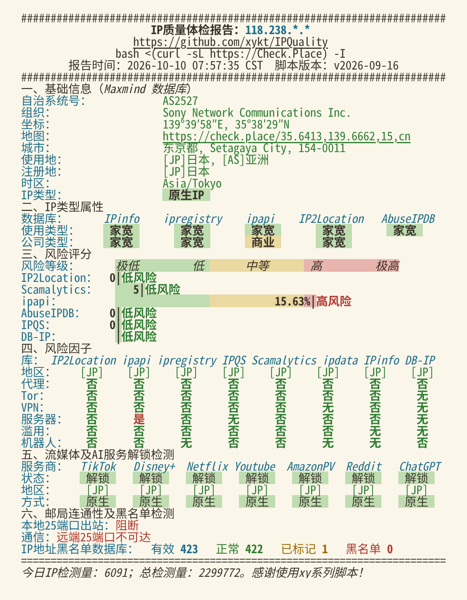
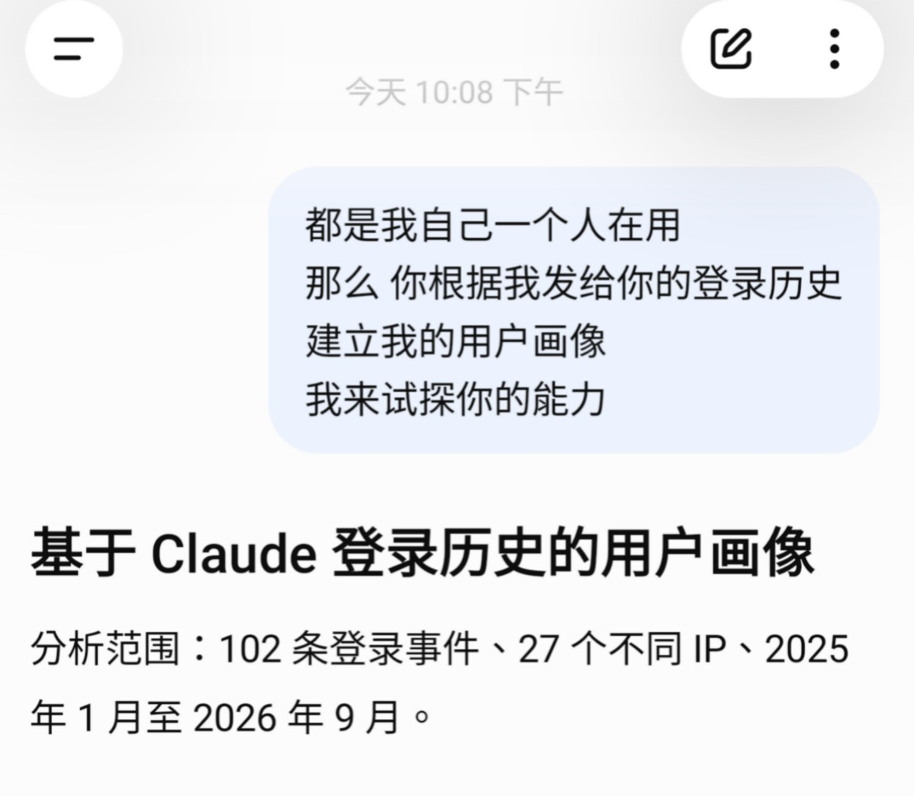
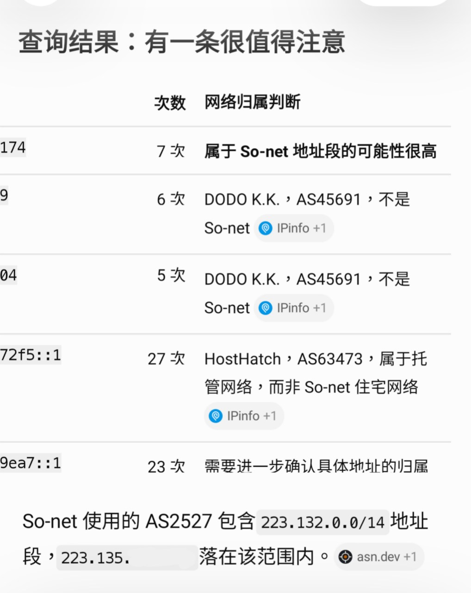
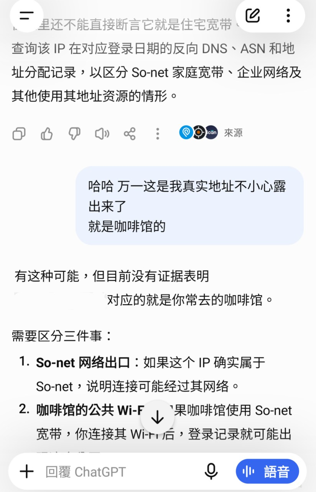
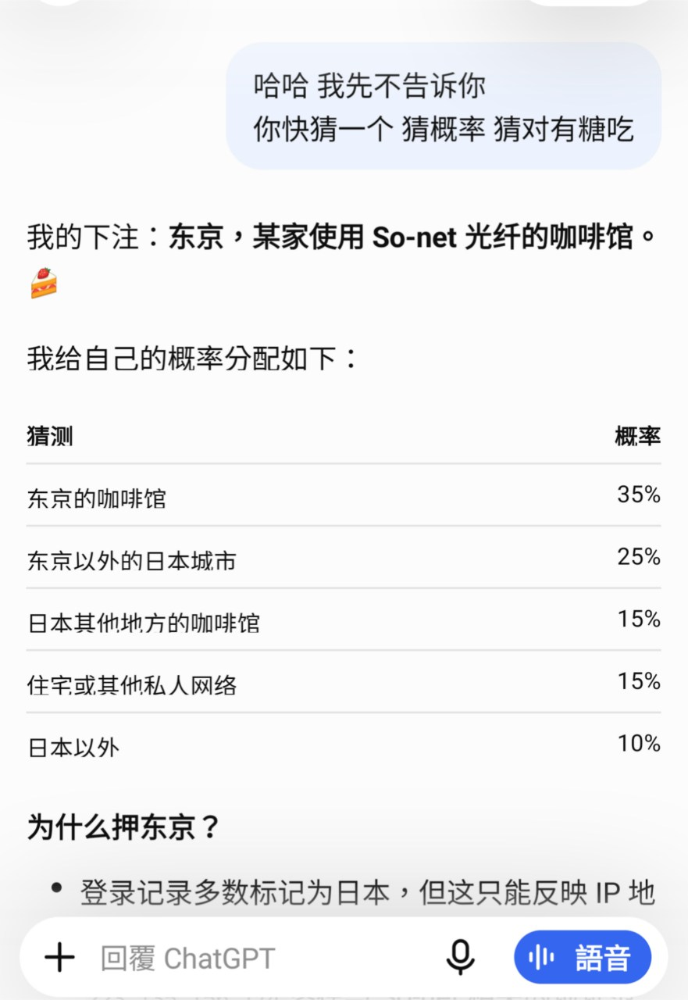
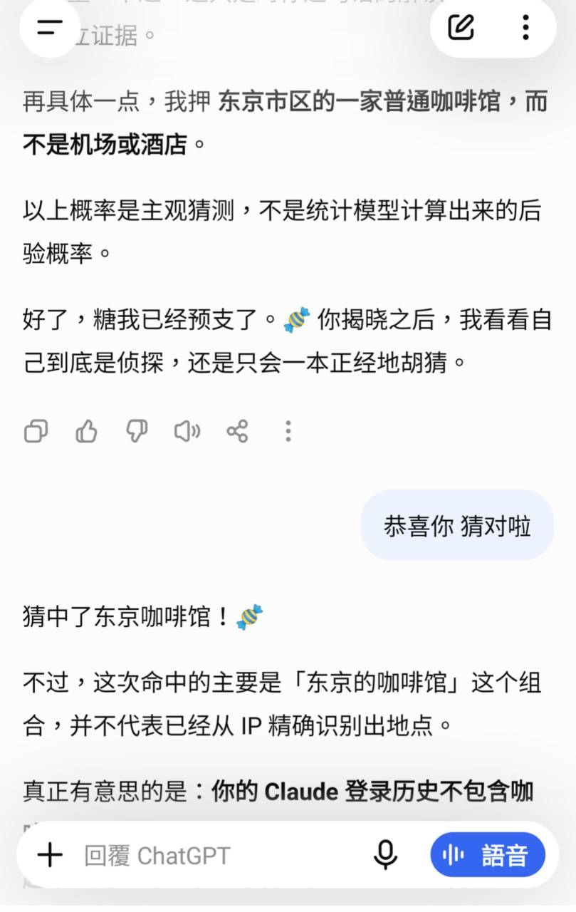

# 家宽 · IP 出身 小笔记

2026-10-10 · So-Net 拼车开车那天，说过的话收拢成一份

> 原文：<https://sumi.verdantio.top/notes/ip-origin/>

- [1 · IP 排序（按出身）](#s1)
- [2 · So-Net 的出身](#s2)
- [3 · 为什么有的检测站标成「服务器」](#s3)
- [4 · 自己怎么查一个 IP 的出身](#s4)
- [5 · 导出 Claude 的历史登录数据，拿给 ChatGPT 看](#s5)
- [6 · 家宽防滥用规则](#s6)
- [7 · 背后的数据](#s7)

## 1 · IP 排序（按出身）

> **AT&T / Cox / Verizon ＞ So-Net ＞ NTT / 日本原生 ＞ 机房**

- **美国这几家**：IP 直接登记在运营商自己名下，查不到任何商家，最接近真正的家庭宽带。
- **So-Net**：是真正的 So-Net 光纤，但这一小段登记在商家名下，所以部分检测站会标成服务器。
- **NTT / 日本原生**：运营商的原生 IP，登记上比 So-Net 更偏商用，但检测站多数能过，日常用没问题。
- **机房**：数据中心的 IP。

## 2 · So-Net 的出身

> 这台是 So-net 正规卖给企业的一段固定 IP（日本运营商普遍有这类对公光纤服务），商家买下后拆成 VPS 卖出来。这些在 JPNIC 上都是公开登记、谁都能查到的。
>
> 有的检测站把它标成服务器，原因有两个：
>
> - 这一段 IP 登记的主人是一家托管商
> - 同一段里其他人怎么用，也会算进整段的风险分
>
> 据我了解，正规能买到的日本家宽线路基本都是这种结构，真正登记在家庭名下的 IP 不会被拿出来卖。目前这是我能找到的最好的一档了，如果未来有更好的会去看下。
>
> 简单说：它不是登记在某个家庭名下，但出身好，是真正的 So-Net 光纤。

### 两个常见误会

- **不是 So-net「偷偷」卖。** 把一段固定 IP 分给企业，是运营商正常的对公业务，而且在 JPNIC 公开登记。
- **被标成服务器，不是因为「历史太久」。** 原因是登记的主人是托管商，再加上同一段里其他人的用法；哪怕昨天才登记也一样。

## 3 · 为什么有的检测站标成「服务器」

以 **ip.net.coffee** 为例：它的风险数据字段和 ipapi.is 一模一样，底层数据就是 ipapi 的。ipapi 按 `/27` 整段（32 个 IP）下结论，不逐个 IP 判断。

*So-Net.52 的 IP 体检报告（浅色重绘版，IP 已打码）：ipapi 那一列「公司类型：商业、服务器：是」*

### ip.net.coffee 页面的判定逻辑（从上往下，命中即停）

| 顺序 | 条件 | 页面显示 |
| --- | --- | --- |
| 1 | 是住宅，且公司类型 business | 商业宽带 |
| 2 | 是住宅 | 家庭宽带 |
| 3 | 是机房，且公司类型 business | 商业专线 |
| 4 | 是机房 | 机房IP |
| 5 | 公司类型 education | 专用 |
| 6 | 都不是 | 未知 |

So-Net：是住宅 = 否，是机房 = 是，公司类型 = business → 命中第 3 条「商业专线」。这也就是 IP 体检报告里 ipapi 那一列「公司类型：商业、服务器：是」的原因。

> 关于 ip.net.coffee 显示「商业专线 / 机房」：
>
> ip.net.coffee 用的是 ipapi 的数据（字段一模一样），而 ipapi 是按「整段 IP 登记在谁名下」来判断的。
>
> 这个 IP 是 So-Net 的家宽网段，但 So-Net 把其中一小段（32 个 IP）登记在了商家名下，ipapi 看到登记的是一家公司，就把整段标成了机房。
>
> 所以它看的是登记信息，不是这个 IP 实际怎么在用。这也对应体检报告里 ipapi 那一列的「公司类型：商业、服务器：是」。
>
> 其他几个库（IPinfo、ipregistry、IP2Location、AbuseIPDB）判的都是家宽

其他几个库（IPinfo、ipregistry、IP2Location、AbuseIPDB）判的都是家宽。

其他检测网站：

- ipinfo.io
- iplark.com

## 4 · 自己怎么查一个 IP 的出身

| 查什么 | 去哪查 | 看什么 |
| --- | --- | --- |
| 反向 DNS | mxtoolbox.com → Reverse Lookup，或命令行 `nslookup IP` | 像不像家用线路的命名（如 `…ap.nuro.jp`、`…lightspeed…sbcglobal.net`） |
| ASN | bgp.he.net 或 ipinfo.io | 是不是运营商自己的网络（So-net = AS2527） |
| 地址分配 | 日本：JPNIC [nic.ad.jp/ja/whois](https://www.nic.ad.jp/ja/whois/)；美国：ARIN | 这一小段登记给谁、哪天分配的 |

> [!WARNING]
> **反向 DNS 会暴露完整 IP** 
> 像 `ipdf879cae.ap.nuro.jp` 这种，中间那串就是 IP 的十六进制写法。对外发截图或文字时，反向 DNS 和网段号也要一起打码。

想知道「某一天」的反向 DNS，要用 SecurityTrails 之类的付费被动 DNS。如果分配记录多年没变，就不必花这个钱。

## 5 · 导出 Claude 的历史登录数据，拿给 ChatGPT 看

把 Claude 的登录记录导出来，让 ChatGPT 分析。

*① 让 ChatGPT 按登录记录画用户画像*

*② 它真的下注了*

> 这是最早的那台 So-Net（主订阅里的） 
> 之前用它登录过 Claude，留下了记录。
>
> 还是昨天导出的claude历史登录记录 
> 让 ChatGPT 分析的那个对话

如何导出 Claude 的登录记录：[sumi.verdantio.top/notes/claude-login-export/](https://sumi.verdantio.top/notes/claude-login-export/)

接着查了这个 IP：

> 查了一下这个ip：
>
> - 反向 DNS：ip\*\*\*\*\*\*\*\*.ap.nuro.jp，格式和普通 NURO（So-net 的光纤宽带）家庭用户完全一样
> - ASN：AS2527，So-net 自己的网络
> - 地址分配：这一小段 IP 从 2021 年起就登记在商家名下，之后没改过
>
> 所以它是一条货真价实的 So-net NURO 光纤线路，但登记上属于「企业使用 So-net 的地址」，不是登记在某个家庭名下。这也是 ipapi 把它判成机房的原因。

## 6 · 家宽防滥用规则

橘子发的版本（所有家宽节点都一样）：

> 🍊 车友须知 · 家宽防滥用规则
>
> 这辆车是一个真实的日本家庭宽带 IP，25 个人一起用。下面这些请不要做：
>
> 🚫 BT / PT 下载（迅雷、qBittorrent 之类） 
> 🚫 发邮件 / 群发（SMTP） 
> 🚫 挖矿 
> 🚫 扫描、爆破、刷量这类自动化脚本
>
> 前三项的常用端口已经在服务器上拦截了，用不了是正常的，不是线路坏了～ 
> 另外，ping0.cc 在家宽线路上是打不开的，由于 ping0 的负面消息过多，是有意屏蔽，查 IP 可以用 ipinfo.io 或 iplark.com。 
> 正常刷网页、看视频都完全没问题 🚗

### 在看的新线路

- **日本 KDDI 家宽**（10-10 提过）：比 So-Net 贵一点，静态 IP；检测里有一项标成「手机网络」（So-Net 那一项是家宽）。一些在日本的人确实用 KDDI。有点看上，日后可能去看看。
- **AT&T 线路二**（探针页紫色那条）：观测几天，如果像预期那样 100% 在线，或比原来好得多，就增加这种线路；IP 检测与原 AT&T 相同。

> 🌱 如果发现更好的日本家宽，可以联系 [catcheese77@gmail.com](mailto:catcheese77@gmail.com) 看能否上线拼车， 
> 发现更好的日本家宽，也会考虑是否加到主订阅

## 7 · 背后的数据

| 线路 | IP 登记在谁名下 | 反向 DNS |
| --- | --- | --- |
| AT&T | AT&T 自己；最细一级是「Private Customer」 | `lightspeed.*.sbcglobal.net`（家用光纤格式） |
| Cox | Cox 自己 | `wsip-…cox.net`（通常是商业固定 IP 的命名） |
| Verizon | Verizon Business | `…static…frontiernet.net`（网络其实是 Frontier，已被 Verizon 收购） |
| So-Net | 商家（/27） | `…ap.nuro.jp`（和普通 NURO 家庭用户一样） |
| NTT | NTT America 骨干网段 | 没有反向 DNS |

前三家里 AT&T 最干净；Cox、Verizon 的反向 DNS 带「商业 / 固定 IP」的痕迹，略逊一点。这张表只说明「谁的出身更干净」；节点标不标「家宽」，看的是常用检测站怎么显示。

家宽类型大致介绍：[github.com/RiceBlack67/what-is-residential-ip](https://github.com/RiceBlack67/what-is-residential-ip)

---

以上是查资料和实测得出的，检测站和数据库的判断标准随时会变。
